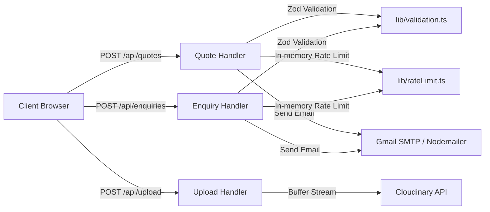

# Backend Architecture Assessment Report

**Project:** Prolink Web Platform  
**Target File:** `documentation/first.md`  
**Date:** October 18, 2026  
**Status:** Complete Audit  

---

## 1. Executive Summary

### Does this website have a "proper backend"?
**Short Answer:** **No.** The website does not have a conventional or complete backend.

Instead, the website currently operates on a **lightweight serverless lead-forwarding layer** built with Next.js App Router route handlers. It acts as a stateless conduit: when a customer submits an inquiry or quote request, the server validates the input, uploads any attachments to Cloudinary, and triggers transactional emails via Gmail SMTP (Nodemailer). 

**There is no database, no persistent record of inquiries, no authentication system, and no administrative API or dashboard.**

| Capability | Current State | Notes |
| :--- | :---: | :--- |
| **Database / Data Persistence** | ❌ None | Inquiries, quotes, and products are not saved to any database. |
| **Product & Catalog Management** | ⚠️ Static Data | All products, machinery, and categories are hardcoded in TypeScript files. |
| **User Authentication & Roles** | ❌ None | No login, session management, password hashing, or admin accounts. |
| **Admin Dashboard / CMS** | ❌ None | Marked as "On Hold / Deferred" in project specifications. |
| **API Endpoints** | ✅ 3 Handlers | `/api/quotes`, `/api/enquiries`, and `/api/upload`. |
| **Third-Party Integrations** | ✅ Operational | Cloudinary (file storage) and Nodemailer via Gmail SMTP. |
| **Spam & Abuse Protection** | ⚠️ Ephemeral | In-memory sliding-window IP rate limiter (resets across serverless instances). |

---

## 2. What Is Currently Implemented

The current backend logic lives in [app/api/](file:///home/tuhin/Documents/website/app/api) and [lib/](file:///home/tuhin/Documents/website/lib). It consists of three serverless route handlers:

### 1. Quotation Handler (`POST /api/quotes`)
- **Location:** [app/api/quotes/route.ts](file:///home/tuhin/Documents/website/app/api/quotes/route.ts)
- **Runtime:** Node.js Serverless Function.
- **Functionality:**
  - Validates payload using [QuoteRequestSchema](file:///home/tuhin/Documents/website/lib/validation.ts) (Zod).
  - Generates a reference code (e.g. `PRL-20261018-ABCD`).
  - Calls [sendQuoteEmails](file:///home/tuhin/Documents/website/lib/email.ts) to send a confirmation email to the client and a notification email to the sales inbox.
  - Returns a standard JSON response (`{ success: true, data: { referenceId } }`).

### 2. General Contact Handler (`POST /api/enquiries`)
- **Location:** [app/api/enquiries/route.ts](file:///home/tuhin/Documents/website/app/api/enquiries/route.ts)
- **Functionality:**
  - Validates contact form fields via [ContactEnquirySchema](file:///home/tuhin/Documents/website/lib/validation.ts).
  - Sends a notification email to the sales inbox.
  - Returns confirmation response.

### 3. File Upload Handler (`POST /api/upload`)
- **Location:** [app/api/upload/route.ts](file:///home/tuhin/Documents/website/app/api/upload/route.ts)
- **Functionality:**
  - Validates MIME types (JPG, PNG, WEBP, PDF, DOCX) and enforces a 15 MB file size ceiling.
  - Streams file buffers directly to Cloudinary using [uploadBuffer](file:///home/tuhin/Documents/website/lib/cloudinary.ts).
  - Returns the Cloudinary secure URL for tech packs and artwork attachments.

### 4. Supporting Utilities in `lib/`
- [lib/email.ts](file:///home/tuhin/Documents/website/lib/email.ts): Handles Nodemailer transport configuration and HTML email formatting.
- [lib/cloudinary.ts](file:///home/tuhin/Documents/website/lib/cloudinary.ts): Cloudinary v2 SDK wrapper.
- [lib/rateLimit.ts](file:///home/tuhin/Documents/website/lib/rateLimit.ts): In-memory Map-based rate limiter (5 submissions per 10 minutes per IP).
- [lib/http.ts](file:///home/tuhin/Documents/website/lib/http.ts): Standard response helpers (`ok`, `fail`, `getClientIp`, `referenceId`).

---

## 3. Critical Missing Components of a "Proper Backend"

A standard production backend requires persistence, authentication, state management, and administrative control. Here is why the current implementation falls short:

### 1. No Database / Zero Data Persistence
- **Current reality:** There is no database connected (no PostgreSQL, MySQL, MongoDB, SQLite, Supabase, or Firebase).
- **The risk:** Quote requests and customer messages are **ephemeral**. If Google SMTP fails, if the sales mailbox is full, or if credentials expire, **the lead is permanently lost** with no database backup or retry record.
- **Spec vs. Code discrepancy:** While [specs/backend/database_schema.md](file:///home/tuhin/Documents/website/specs/backend/database_schema.md) defines 8 comprehensive database tables (`AdminUsers`, `Categories`, `Products`, `Services`, `Enquiries`, `QuoteRequests`, `GalleryItems`, `Settings`), **none of these tables or schemas have been implemented in code**.

### 2. Static / Hardcoded Product Catalog
- The entire product catalog, uniform lines, machinery specs, and capabilities are hardcoded static TypeScript arrays:
  - [data/products.ts](file:///home/tuhin/Documents/website/data/products.ts)
  - [data/machinery.ts](file:///home/tuhin/Documents/website/data/machinery.ts)
  - [data/capabilities.ts](file:///home/tuhin/Documents/website/data/capabilities.ts)
  - [data/uniforms.ts](file:///home/tuhin/Documents/website/data/uniforms.ts)
- Adding, editing, or deleting a product or price requires a developer to write code, commit to Git, and trigger a new deployment. There is no CRUD API or headless CMS.

### 3. No Authentication or Role-Based Access Control
- No authentication system exists (e.g., Auth.js / NextAuth, Supabase Auth, Clerk, or JWT).
- There are no user accounts, password hashing libraries (bcrypt/argon2), or session management.

### 4. No Admin Portal or Back-Office Interface
- Sales staff cannot log into the site to review incoming quotation requests, change statuses (`NEW`, `IN_REVIEW`, `QUOTED`, `WON`), write internal notes, or export customer leads.
- In [specs/frontend/admin_dashboard.md](file:///home/tuhin/Documents/website/specs/frontend/admin_dashboard.md) and [specs/backend/architecture_and_api.md](file:///home/tuhin/Documents/website/specs/backend/architecture_and_api.md), this was intentionally marked as **"ON HOLD / DEFERRED"**.

### 5. In-Memory Rate Limiting on Serverless Infrastructure
- [lib/rateLimit.ts](file:///home/tuhin/Documents/website/lib/rateLimit.ts) stores hit counts in a Node.js in-memory `Map` (`const buckets = new Map<string, Hit>()`).
- When deployed on Vercel or any serverless platform, each serverless invocation may run in a fresh, isolated container. As noted in the file's own docstring:
  > *"Note: serverless instances don't share memory, so this is best-effort — a durable store (Upstash/Redis) would be the upgrade if stricter limits matter."*
- Consequently, attackers can bypass the 5-requests-per-10-minutes limit by hitting different lambda instances.

---

## 4. Why Is It Configured This Way? (Project Scope Context)

The codebase architecture is not an oversight; it was intentionally designed as a **lean, low-overhead B2B lead generation website**:

1. **Explicit Project Directives:**  
   In [claude.md](file:///home/tuhin/Documents/website/claude.md) (Section 4), the scope explicitly states:
   - *In Scope:* Public Customer Website, Quotation & Lead Pipeline via SMTP and Cloudinary.
   - *Strictly Out of Scope / Deferred:* Admin Panel, Payment System, Database CRUD.
2. **Speed & Zero Database Hosting Costs:**  
   By bypassing a database, the website can be deployed directly to Vercel with zero database maintenance, connection pooling overhead, or hosting costs.

---

## 5. Architectural Comparison: Current vs. Proper Backend

| Architecture Dimension | Current Implementation | "Proper" Production Backend |
| :--- | :--- | :--- |
| **Persistence** | None (Fire-and-forget email) | PostgreSQL / MySQL via Prisma or Drizzle ORM |
| **Catalog Storage** | Static TypeScript files in `/data` | Relational database with full-text search & indexing |
| **Lead Management** | Customer & Sales Inbox Emails | Relational `QuoteRequests` and `Enquiries` tables with status transitions |
| **File Management** | Direct upload to Cloudinary | Direct upload to Cloudinary with asset IDs stored in DB |
| **Auth & Security** | None | OAuth2 / JWT session cookies with RBAC (`SUPER_ADMIN`, `MANAGER`) |
| **Rate Limiting** | Ephemeral in-memory Map | Distributed Redis / Upstash sliding window rate limiting |
| **Background Queues** | Synchronous execution during HTTP request | Durable queue (BullMQ, Celery, or QStash) for email & file jobs |
| **Admin Operations** | None (Code edits required) | Web dashboard for catalog updates and lead pipeline tracking |

---

## 6. Recommendations & Roadmap to Upgrade

If Prolink requires a full, production-grade backend, the following steps should be taken:

### Step 1: Add a Relational Database & ORM
- **Recommended Stack:** PostgreSQL (via Neon, Supabase, or AWS RDS) + **Prisma ORM** or **Drizzle ORM**.
- Implement the models specified in [specs/backend/database_schema.md](file:///home/tuhin/Documents/website/specs/backend/database_schema.md):
  - `QuoteRequests` (stores client info, quantity, spec notes, attachment URLs, status).
  - `Enquiries` (stores general inquiries and response status).
  - `Products` & `Categories` (dynamic catalog replacing static arrays).

### Step 2: Implement Persistent Lead Ingestion
- Update `POST /api/quotes` and `POST /api/enquiries` to:
  1. Validate payload via Zod.
  2. Write record directly to the database.
  3. Send emails asynchronously as notifications rather than the sole record of the lead.

### Step 3: Implement Authentication & Admin Dashboard
- Integrate **Auth.js (NextAuth v5)** or **Supabase Auth** with role-based checks.
- Build the deferred Admin Dashboard from [specs/frontend/admin_dashboard.md](file:///home/tuhin/Documents/website/specs/frontend/admin_dashboard.md) to enable sales staff to:
  - View, filter, and export quotation requests.
  - Update quotation status and record quote amounts.
  - Manage catalog garments without needing code changes.

### Step 4: Durable Rate Limiting
- Replace the in-memory Map in [lib/rateLimit.ts](file:///home/tuhin/Documents/website/lib/rateLimit.ts) with **@upstash/ratelimit** and Redis.

---

## 7. Conclusion

**Verdict:** The website currently has **API route handlers with external integrations (Email & Cloudinary)**, but **it does not have a proper backend**. 

For its immediate initial launch as a B2B marketing showcase, this lightweight setup functions as intended. However, for long-term scalability, data security, catalog flexibility, and lead management, transitioning to a database-backed architecture is strongly recommended.
