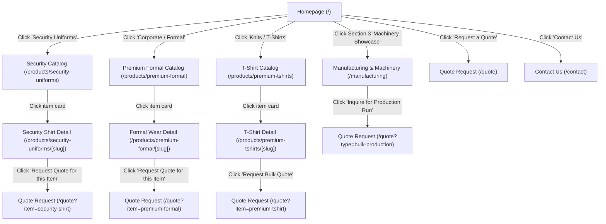

# Project Directory Architecture & Engineering Workflow

## 1. Next.js App Router Directory Structure
Claude must scaffold the project following this clean, modular architecture. **This is strictly a Multi-Page Application (MPA) with distinct routes — NOT a single-page scrolling site**:

```text
├── app/                                 # Next.js App Router (Dedicated Multi-Page Routes)
│   ├── layout.tsx                       # Root Layout: Header, Footer, Meta, Fonts, Theme
│   ├── page.tsx                         # Homepage (1: Hero, 2: Flagship Lines, 3: Sewing Machines, 4: CTAs)
│   ├── about/page.tsx                   # Company background & production credentials
│   ├── manufacturing/page.tsx           # Manufacturing capabilities & Machinery tour (from specs/frontend/sewing_machine)
│   ├── products/                        # Catalog Multi-Page Architecture
│   │   ├── page.tsx                     # All Products overview & category navigation
│   │   ├── security-uniforms/           # Dedicated Security Uniforms section
│   │   │   ├── page.tsx                 # Security uniform catalog listing
│   │   │   └── [slug]/page.tsx          # Security shirt product detail & specs
│   │   ├── premium-formal/              # Dedicated Premium Formal section
│   │   │   ├── page.tsx                 # Formal wear catalog listing
│   │   │   └── [slug]/page.tsx          # Formal shirt/trouser product detail
│   │   └── premium-tshirts/             # Dedicated T-Shirt section
│   │       ├── page.tsx                 # 180-200 GSM T-shirt catalog listing
│   │       └── [slug]/page.tsx          # T-shirt product detail (GSM, color selector)
│   ├── quote/page.tsx                   # Multi-step B2B Quotation Request Form (receives pre-filled URL params)
│   ├── contact/page.tsx                 # Direct inquiry form, address & contact channels
│   └── api/                             # Serverless Route Handlers
│       ├── quotes/route.ts              # Handle B2B quote request + SMTP notification
│       ├── enquiries/route.ts           # Handle general contact submissions + SMTP
│       └── upload/route.ts              # Cloudinary upload handler / signature generator
├── components/                          # Reusable UI & Layout Components
│   ├── layout/                          # Header, Navigation, MobileMenu, Footer
│   │   ├── Header.tsx                   # Top bar with Prolink logo and multi-page links
│   │   └── Footer.tsx                   # Company credentials, sitemap, category links
│   ├── home/                            # Homepage-specific sections
│   │   ├── Hero.tsx                     # Value proposition & quick action CTAs
│   │   ├── FlagshipShowcase.tsx         # 3 Core product collections preview
│   │   ├── MachineryShowcase.tsx        # 3rd Section: Sewing machines preview -> links to /manufacturing
│   │   └── WhyChooseUs.tsx              # Quality, MOQ flexibility, global export
│   ├── catalog/                         # Product presentation
│   │   ├── ProductCard.tsx              # Card with image, category, and link to detail page
│   │   ├── ProductGallery.tsx           # Thumbnail switcher / zoom preview
│   │   └── SpecTable.tsx                # GSM, fabric composition, stitch details
│   ├── quote/                           # Quotation Flow
│   │   ├── QuoteWizard.tsx              # Multi-step form container
│   │   ├── FileUploadDropzone.tsx       # Tech pack & design sample uploader
│   │   └── SpecificationPicker.tsx      # Fabric blend, GSM, and quantity selectors
│   └── ui/                              # Atomic UI components
│       ├── Button.tsx, Input.tsx, Modal.tsx, Badge.tsx
├── data/                                # Ingested product catalog & machinery data
│   ├── products.ts                      # Parsed products from JPEG scans with specs
│   └── machinery.ts                     # Machinery catalog from specs/frontend/sewing_machine
├── lib/                                 # Utilities & Third-Party SDK Integrations
│   ├── email.ts                         # Nodemailer transporter & branded HTML email templates
│   ├── cloudinary.ts                    # Cloudinary client & upload helper
│   ├── validation.ts                    # Zod schemas for quote form & contact submissions
│   └── tokens.ts                        # Prolink brand design constants (colors, fonts)
├── public/                              # Static public assets
│   ├── images/                          # Prolink logo, banners, icons
│   └── catalog/                         # Ingested product & machinery JPEG photos
└── specs/                               # Master requirements & reference photos
```

---

## 2. Multi-Page User Routing Flow & Navigation Journey

This platform is strictly **Multi-Page**. Every category, product, capability, and contact form has its own dedicated URL. Below is the precise page transition sequence:



### Detailed Route Transition Sequence:

1. **Security Uniforms Journey**:
   - **Step 1**: User on `Homepage (/)` clicks "Security Uniforms" (in navigation or collection grid).
   - **Step 2**: Navigates to **`/products/security-uniforms`** (shows all security shirts, epaulet variants, heavy-duty stitching options from `specs/frontend/security_shirt`).
   - **Step 3**: User clicks a specific product card -> opens **`/products/security-uniforms/[slug]`** (e.g. `/products/security-uniforms/heavy-duty-patrol-shirt`).
   - **Step 4**: Product Detail displays full technical specs table (Poly-Cotton 65/35, reinforced pockets, badge tab, size chart) with a prominent CTA button: **"Request Quote for this Item"**.
   - **Step 5**: Clicking CTA routes to **`/quote?item=security-shirt&sku=SEC-01`**, pre-selecting Security Uniform in the quote wizard.

2. **Premium Formal Journey**:
   - **Step 1**: User clicks "Corporate / Premium Formal" on `Homepage (/)` or header nav.
   - **Step 2**: Navigates to **`/products/premium-formal`** (displays formal shirts, trousers, custom collar/cuff options from `specs/frontend/premium_formal`).
   - **Step 3**: User clicks a product card -> opens **`/products/premium-formal/[slug]`** (e.g. `/products/premium-formal/executive-oxford-shirt`).
   - **Step 4**: Displays high-thread-count fabric specs, collar styles, and embroidery options.
   - **Step 5**: CTA routes to **`/quote?item=premium-formal`** with pre-filled category.

3. **Premium 180–200 GSM T-Shirt Journey**:
   - **Step 1**: User clicks "T-Shirts & Knits" on `Homepage (/)` or header nav.
   - **Step 2**: Navigates to **`/products/premium-tshirts`** (displays 180–200 GSM combed cotton polo and crew neck tees from `specs/frontend/premium_180-200gsm_tshirt`).
   - **Step 3**: User clicks a product card -> opens **`/products/premium-tshirts/[slug]`**.
   - **Step 4**: Interactive GSM selector (180 GSM vs 200 GSM) and color fastness badge.
   - **Step 5**: CTA routes to **`/quote?item=premium-tshirt&gsm=180-200`**.

4. **Factory Machinery & Sewing Infrastructure Journey**:
   - **Step 1**: On `Homepage (/)`, user reaches **Section 3: Factory Machinery Showcase**.
   - **Step 2**: User clicks "Explore Our Factory & Machinery" button.
   - **Step 3**: Navigates to **`/manufacturing`** (dedicated multi-page gallery showcasing commercial sewing machinery, automated stitching lines, plant capacity, and QA inspection stations from `specs/frontend/sewing_machine`).
   - **Step 4**: User clicks "Book Production Capacity / Inquire for Bulk Manufacturing".
   - **Step 5**: Routes to **`/quote?type=bulk-manufacturing`**.

---

## 3. Step-by-Step Implementation Workflow for Claude

### Step 1: Scaffolding & Design Foundation
1. Initialize Next.js project with TypeScript, ESLint, and App Router.
2. Port and lock the design system directly from `styles.css`:
   ```css
   :root {
     --maroon: #5c0f1f;
     --maroon-deep: #3a0812;
     --gold: #b8893b;
     --gold-soft: #e3c98f;
     --ivory: #fbf6ec;
     --sand: #f3e9d6;
     --ink: #2a1a16;
     --muted: #6d5a52;
     --line: #e2d3b8;
     --serif: "Cormorant Garamond", Georgia, serif;
     --sans: "Jost", system-ui, -apple-system, sans-serif;
     --radius: 14px;
     --header-h: 68px;
   }
   ```
3. Do NOT use blue as the theme color even if catalog scans or proposal files display blue backgrounds.
4. **Strict Fluid Sizing Rule (NO HARDCODED `px`)**:
   - Never hardcode fixed pixel (`px`) values for widths, heights, paddings, margins, or font sizes.
   - Use fluid relative units: `rem`, `clamp()`, `vw`, `%`, `ch`, and auto-fitting grid templates (`repeat(auto-fit, minmax(min(100%, 20rem), 1fr))`).
   - All pages and components must adapt seamlessly to mobile phones, tablets, laptops, and ultra-wide desktops without horizontal scrolling.
5. Set up base layout (`app/layout.tsx`) incorporating the Prolink logo in `Header.tsx` with frosted glassmorphic navigation on scroll and multi-page links.

### Step 2: Catalog Data Ingestion from Folders
1. Inspect images in `specs/frontend/security_shirt/`, `specs/frontend/premium_formal/`, `specs/frontend/premium_180-200gsm_tshirt/`, and `specs/frontend/sewing_machine/`.
2. Construct structured product objects in `data/products.ts` and `data/machinery.ts` representing key models, technical attributes (GSM, fabric, collars, stitches), slugs, and image paths.

### Step 3: Multi-Page Route Construction
1. Build `app/page.tsx` with the specified section sequence (Hero -> Collections Preview -> Section 3: Sewing Machines -> Why Prolink -> Quote CTA).
2. Build dedicated category listing pages (`app/products/security-uniforms/page.tsx`, `app/products/premium-formal/page.tsx`, `app/products/premium-tshirts/page.tsx`).
3. Build dynamic product detail pages (`app/products/[category]/[slug]/page.tsx` or `[slug]/page.tsx`) with technical specifications tables and "Request Quote for this Item" CTAs.
4. Build dedicated manufacturing capabilities page (`app/manufacturing/page.tsx`) with sewing machine gallery.
5. Build interactive B2B quote request page (`app/quote/page.tsx`) supporting pre-filled product query parameters.
6. Build contact page (`app/contact/page.tsx`).

### Step 4: Backend API & Integrations
1. Create `app/api/quotes/route.ts` with Zod validation.
2. Configure Nodemailer in `lib/email.ts` to dispatch transactional emails to both client and sales team via Gmail SMTP.
3. Configure Cloudinary client in `lib/cloudinary.ts` for file attachments.

### Step 5: Verification & Polish
1. Test route transitions across all multi-page links.
2. Verify that clicking "Request Quote" from any product detail page pre-fills the quote form correctly.
3. Verify mobile, tablet, and desktop responsiveness.
